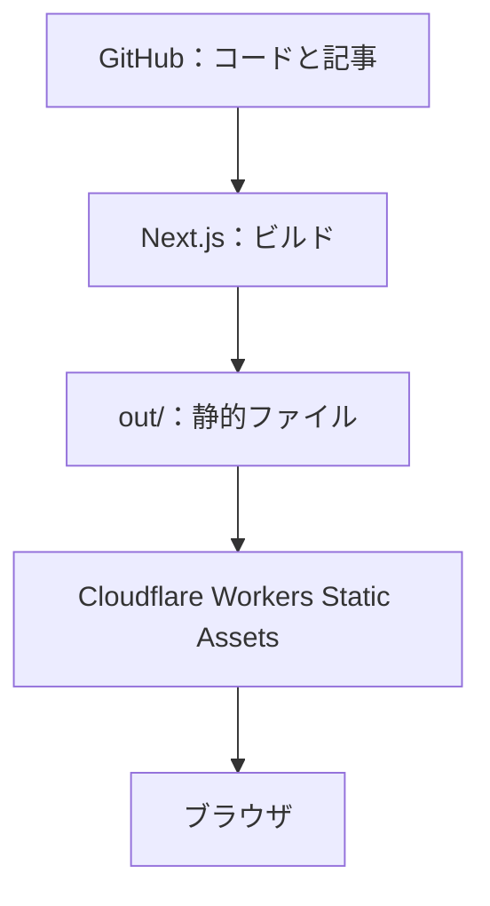
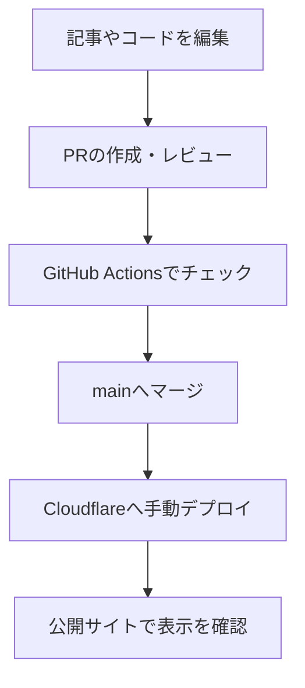

## 公式サイトを作りました

舞鶴高専プログラマーズコミュニティ部の公式サイトを作りました。

部活で何をしているのか、どんなものを作っているのか。そういう情報を、ひとつの場所で見られるサイトです。

この記事では、サイトで見られることに加えて、使っている技術や、変更が公開されるまでの流れを紹介します。

## 何が見られるのか

サイトには、部の活動や作品、大会・イベントの実績をまとめています。

- [活動紹介](/activities/)：競技プログラミングや開発など、部の活動について
- [作品紹介](/works/)：部員が作った作品について
- [大会・イベント実績](/results/)：大会への出場や受賞の記録
- [お知らせ](/news/)：活動報告やイベントなどの情報
- [ブログ](/blog/)：部員による記事

それぞれ一覧から詳細ページに進めます。気になるものがあれば、のぞいてみてください。

## サイトの全体像

ソースコードや記事のデータをGitHubで管理し、Next.jsで静的ファイルを生成します。生成したファイルをCloudflareにデプロイすると、ブラウザから見られるようになります。



ポイントは、アクセスされるたびにサーバーでページを生成するのではなく、**ビルド時にHTMLを生成しておく**ことです。現在のサイトには、データベースやログイン機能はありません。

## 何で作ったのか

主に次の技術を使っています。

- **Next.js（App Router）**：ページのルーティングやビルドを担当します。
- **React**：見出しや記事一覧など、画面を部品に分けて組み立てます。
- **TypeScript**：記事や作品のデータの型を確認します。
- **Tailwind CSS・CSS**：画面のスタイルを定義します。
- **Three.js**：一部のページで背景のビジュアルを描画します。
- **Cloudflare Workers Static Assets**：ビルドした静的ファイルを配信します。

Next.jsは `output: 'export'` に設定しています。`pnpm build` で、配信用のHTMLや画像などが `out/` に出力されます。お問い合わせなどを含む各ページや、公開済み記事の詳細ページも静的ファイルとして生成します。

## 記事や作品はどこにあるのか

ページに表示する情報は、主に `src/content/` のTypeScriptファイルで管理しています。たとえば、お知らせやブログのタイトル、日付、カテゴリなどは `src/content/news.ts` にあります。

ブログ本文は、同じディレクトリ内のMarkdownファイルに分けて書くこともできます。この記事の場合、本文は `src/content/news/official-website.md` です。

```text
src/content/
├── news.ts                 お知らせ・ブログの情報
├── news/                   Markdown形式のブログ本文
├── works.ts                作品の情報
├── activities.ts           活動の情報
└── results.ts              大会・イベント実績
```

記事を下書きにしている間は公開一覧に表示されません。公開するときは内容を確認し、公開設定と公開記事のslug一覧を更新します。詳しい手順は、リポジトリの[コンテンツ更新ガイド](https://github.com/NIT-Maizuru-Programmers-Community/Official_site/blob/main/docs/content-guide.md)にまとめています。

## 変更してから公開するまで

リポジトリを変更するときは、作業ブランチで編集してPull Requestを作ります。レビューと確認を通して `main` にマージした後、Cloudflareへデプロイします。



公開前の `pnpm check` では、整形、Lint、型チェック、テスト、ビルド、静的出力の確認を実行します。GitHub Actionsでも、PRや `main` への変更に対して同じチェックを実行します。

`main` にマージするだけで自動公開されるわけではありません。現状は、検証後にビルドした `out/` をWranglerで手動デプロイします。更新の手順と公開の手順は、それぞれ確認しながら進めます。

## ここから更新していきます

公式サイトは、作って終わりではありません。

活動の様子や作品、お知らせを少しずつ追加して、部のことが伝わる場所にしていきます。このブログでも、ものづくりや活動について発信していく予定です。

まずは、[作品紹介](/works/)から見てみてもらえるとうれしいです。
